# spinreadme

A Spotify "now playing" card for your GitHub profile README.

[](https://spinreadme.baselashraf.com)

Free and hosted. Connect Spotify once, then copy one image link into your README. The bars move while a track plays, and the card shows your last played track when nothing is playing.

**[Get yours](https://spinreadme.baselashraf.com)**

## Themes

Pick one on the setup page, or add `?theme=paper`, `?theme=ink` or `?theme=signal` to the card URL.

| paper | ink | signal |
| --- | --- | --- |
|  |  |  |

## Self-host

The Worker is one file with no dependencies. You need a Cloudflare account and Node 18 or newer.

1. In `wrangler.toml`, replace the `routes` line with your own route, or delete it to use a `workers.dev` URL.
2. Generate the encryption key. It seals the OAuth state and the per-user links:
   ```
   node -e "console.log(require('crypto').randomBytes(32).toString('base64'))"
   npx wrangler secret put SPINDLE_KEY
   ```
3. Deploy with `npm install` then `npm run deploy`.
4. Open `/` on your Worker. It is the setup page: each user enters the client ID and secret of their own Spotify app, approves access, and gets a link like `/c/<token>.svg?theme=ink`.

Spotify limits an app in development mode to 25 users, which is why each person brings their own app.

To serve a single account without the setup page, set `SPOTIFY_CLIENT_ID`, `SPOTIFY_CLIENT_SECRET` and `SPOTIFY_REFRESH_TOKEN` as secrets (`npm run token` prints a refresh token) and use `/card.svg`.

To run locally, put the same variables plus `SPINDLE_KEY` in `.dev.vars` and run `npx wrangler dev`. `npm run preview` regenerates the images in `assets/`.

## License

MIT

Made by [Basel Ashraf](https://baselashraf.com)
